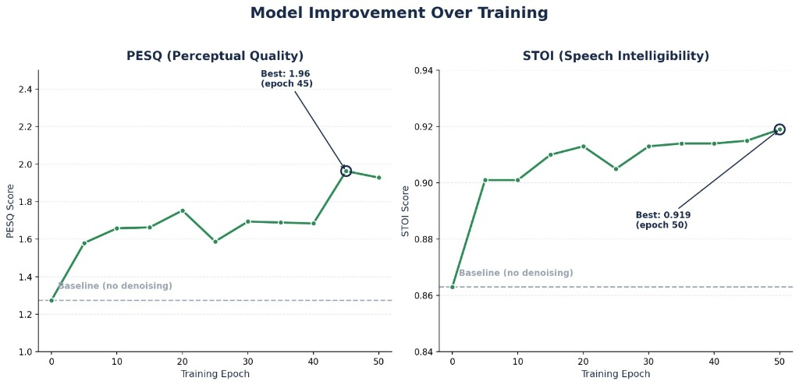
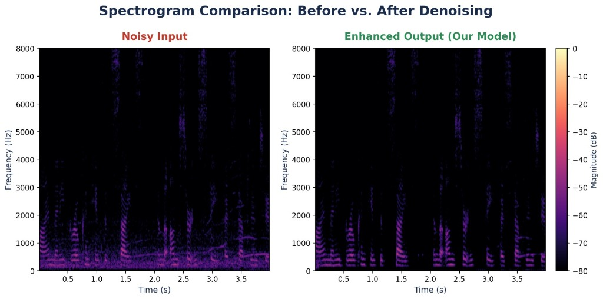

# REQUIEM: AI/ML-Enabled Adaptive Noise Suppression System

**Problem Statement ID: 26052**

REQUIEM is an AI/ML-enabled adaptive noise cancellation (ANC) system designed to effectively suppress stationary, non-stationary, and impulsive defence noises while maintaining high speech intelligibility and real-time performance on embedded hardware.

---

## 1. The Problem
Defence and mission-critical voice communication is severely affected by stationary, non-stationary and impulsive noise. Sources include vehicle and engine noise, aircraft and helicopter noise, radio interference, footsteps, gunfire, artillery and other high-energy disturbances. Such noise can mask critical speech, reduce intelligibility and cause commands to be missed or misunderstood. 

Conventional approaches such as spectral subtraction, Wiener filtering and classical LMS-based adaptive noise cancellation are effective under relatively predictable conditions but can struggle when the acoustic environment changes rapidly or contains strong impulsive events. They may also introduce speech distortion, musical noise and other artifacts. Therefore, a robust solution is required that can handle different types of defence noise while maintaining high speech intelligibility and supporting real-time operation on embedded hardware.

## 2. Solution Proposal: REQUIEM
REQUIEM is an AI/ML-enabled adaptive noise suppression system designed for real-time defence and mission-critical communication. The proposed system combines AI-based speech enhancement, digital signal processing, multi-microphone acquisition and edge inference to suppress complex and rapidly changing noise while preserving the important characteristics of speech. 

Incoming audio is continuously processed through a hybrid AI + DSP pipeline, allowing the system to learn complex temporal and spectral characteristics of noisy environments while retaining an embedded signal-processing stage for further suppression of residual noise. The architecture is designed for low-latency and low-power operation without relying on continuous external computing. The current prototype is implemented as a 160 × 100 mm development board, with further miniaturisation planned for future versions.

## 3. System Architecture
The REQUIEM hardware consists of an audio acquisition stage, embedded processing stage, audio reconstruction stage and supporting sensing and communication interfaces. 

- **Audio Acquisition:** Uses primary and reference MEMS microphones (ICS-40300). The signal is passed through low-noise amplification and anti-alias filtering before conversion using a 24-bit ADS1274 ADC. 
- **Embedded Processing:** The STM32H755 acts as the main embedded controller for audio preprocessing, routing, buffering and real-time signal processing. A Kendryte K210 is the target AI inference platform for running the compact speech-enhancement model. 
- **Audio Reconstruction:** The enhanced signal is reconstructed using a PCM1794A DAC and passed through Class-D amplification to a headset or communication interface. 
- **Sensing & Communication:** Includes the ICM-42688-P IMU for vibration-related information and BMP388 environmental sensing. 

The overall design uses an embedded PCB architecture with separated analogue, digital and power sections.

## 4. AI Model and Training Dataset
The AI component of REQUIEM uses a compact Conv-TasNet-based speech-enhancement architecture selected for its suitability for time-domain speech processing and potential for resource-constrained deployment. The model is being prepared for INT8 quantised edge inference to reduce computational and memory requirements. 

**MAD Dataset (Military Audio Dataset)**
To train the model on highly realistic defence scenarios, we utilize the **MAD dataset**. This is a comprehensive library of real-world military noises containing:
- 8,000+ sound samples
- ~12 hours of audio
- 7 categories of defence noise: Gunfire, artillery/shelling, vehicles, helicopters, jets, footsteps, and radio chatter.

The training pipeline incorporates mixing clean human speech with these MAD samples at different SNRs, and applying augmentation techniques (reverberation, clipping simulation) to improve robustness. 

## 5. Results and Validation
Initial offline evaluation has been performed using held-out noisy speech samples. The model successfully separates speech from background defence noise without prior exposure to the specific test clips.

**Performance Metrics:**
- **PESQ (Clarity):** Improved from 1.28 to 1.93 (+51%)
- **STOI (Intelligibility):** Improved from 0.86 to 0.92 (+6.5%, exceeding the target of 0.85)
- **SI-SNR (Signal Strength):** Improved from 5.0 dB to 12.7 dB (+7.7 dB)

**Spectrogram Analysis:**
As seen in the visual comparison below, the quieter spaces between words appear significantly cleaner and darker, showing massive reduction in background noise while the speech structure itself remains preserved and intact.

The current PESQ and SI-SNR results are ongoing optimisation targets (aiming for PESQ > 2.5 and SNR improvement > 15 dB).

## 6. Embedded Performance Targets
- **Latency:** < 20 ms
- **SNR Improvement:** > 15 dB
- **Power Consumption:** < 5 W
- **Operating Temperature:** -40°C to +85°C

The proposed mitigation approach combines AI-based temporal speech enhancement, multi-microphone acquisition, hybrid AI + DSP processing, INT8 quantisation and edge inference. Adaptive residual filtering is considered as an additional processing stage.

## 7. Prototype BOM (Bill of Materials)
- **Audio Acquisition & Signal Conditioning** (ICS-40300, INA217, MAX7401, ADS1274): ~$71
- **MCU & AI-Processing** (STM32H755, Kendryte K210): ~$40
- **Memory & Sensing** (SDRAM, W25Q128, ICM-42688-P, BMP388): ~$15
- **Audio Output** (PCM1794A, Class-D Amp): ~$34
- **Communication & Power**: ~$12
- **Prototype PCB**: ~$45
- **Estimated Total Prototype BOM:** $230–$250 per board (₹22,000–₹24,000)

## 8. Novelty
The key novelty of REQUIEM lies in combining AI-based speech enhancement with embedded DSP and edge processing within a unified architecture for complex defence communication noise. Instead of relying exclusively on conventional filtering, the system uses a learned speech-enhancement model to capture complex temporal and spectral characteristics of noise while maintaining a DSP stage for residual suppression and signal conditioning.

## 9. Impact and Scalability
REQUIEM improves speech intelligibility in high-noise environments where conventional noise suppression becomes less effective. 
- **Primary Application:** Defence and mission-critical communication (tactical vehicles, field communication, aviation).
- **Scalability:** Modular architecture allows adaptation to different microphones, processors, and environments. Can be extended to emergency-response systems, industrial machinery, and aerospace applications.

## 10. Current Status and Future Work
- **Current Status:** AI model development, data generation methodology, offline evaluation, system architecture, circuit/schematic development, and PCB layout are completed.
- **Future Work:** INT8 model benchmarking, embedded AI integration, real-time hardware validation, headset testing, further optimisation of PESQ/SI-SNR, power optimisation, and PCB miniaturisation.

## 11. References
- Luo and Mesgarani, “Conv-TasNet: Surpassing Ideal Time-Frequency Masking for Speech Separation”, IEEE/ACM.
- Narain, Kant and Singh, “Artificial Intelligence Driven Advances in Noise Cancellation”.
- Kar and Mukherjee, “Acoustic Signal Enhancement Using Deep Neural Networks”.
- “Selective Noise Cancellation Using Machine Learning”.
- ITU-T P.862 methodology for PESQ and STOI methodology.
